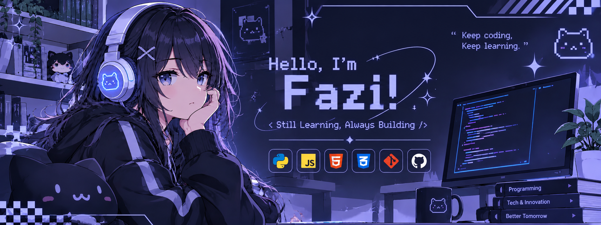

  

# Hi 👋, I'm Fazi!

### Still Learning, Always Bulding

💻 Aspiring Backend Developer

## About Me
- 👤Vocational High School Students  
- 🌱 Currently learning Python
- 🎯 Interested in Backend Development

## 🛠️ Languages and Tools

## My Projects
- Brute Force PIN Simulation
